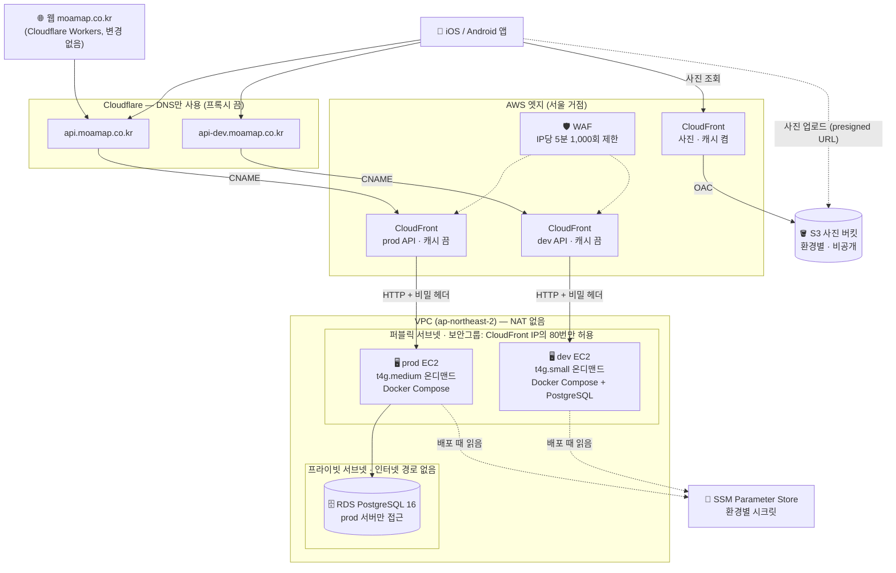
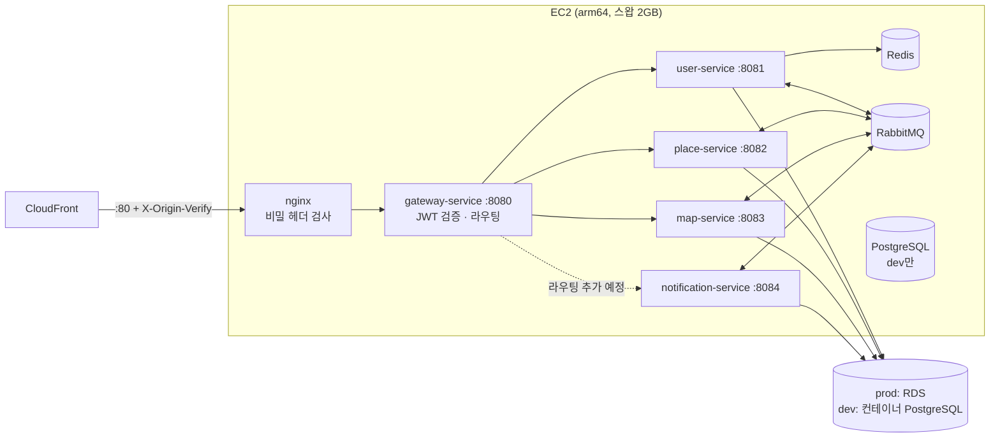
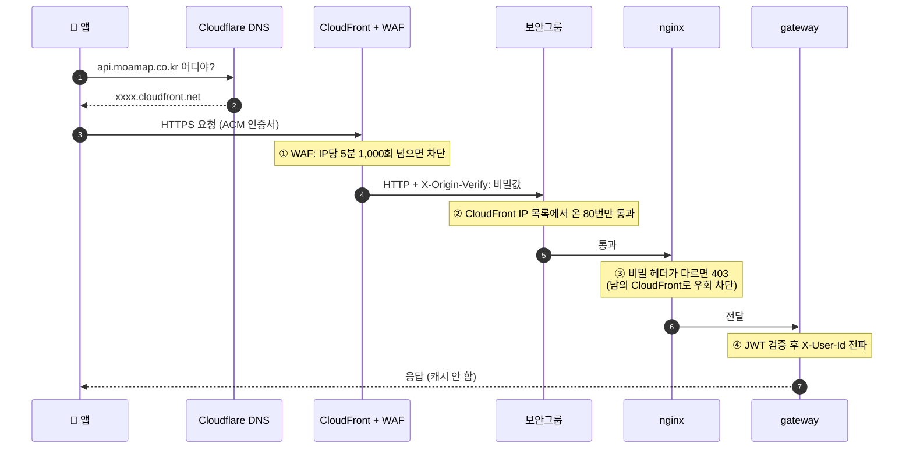
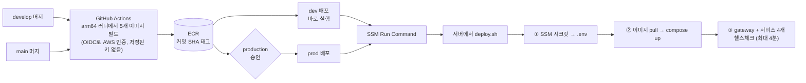
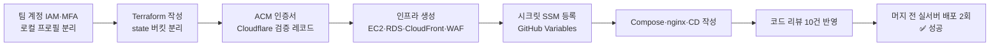

# 모아맵 인프라 — 팀 AWS 계정 (EC2 + Docker Compose + CloudFront)

> 개인 AWS 계정의 쿠버네티스(k3s) 클러스터를 **팀 계정의 EC2 + Docker Compose**로 옮긴 기록이자 운영 문서입니다.
> 관련 이슈 #155 · PR #157. 이전 계정(A)의 스택은 `infra/aws/`에 그대로 있습니다 — **A 정리(destroy)가 끝나기 전까지 지우지 않습니다.**

---

## 한눈에 보기

| | 이전 (A: 개인 계정) | 지금 (B: 팀 계정) |
|---|---|---|
| 실행 방식 | k3s 클러스터 (EC2 3대) + ArgoCD | **EC2 + Docker Compose** (환경별 1대) |
| dev / prod | 분리 안 됨 (dev 빌드 하나가 운영 도메인까지 서비스) | **서버 단위 분리** (서버·DB·버킷·시크릿 전부 따로) |
| 앞단 | Cloudflare 프록시 (한국 요청이 오사카·LA 거점 경유) | **CloudFront 서울 거점** + WAF |
| 사진 | S3 공개 읽기 | **S3 비공개** + CloudFront(OAC) |
| 배포 | 이미지 빌드(QEMU) → 매니페스트 커밋 → ArgoCD | 이미지 빌드(arm64 러너) → **SSM으로 서버에 직접 배포** |
| 인프라 코드 | Terraform + k8s 매니페스트 | **Terraform 하나** (`infra/aws-team/`) |
| 월 비용(추정) | 약 18만 원 | **약 13만 원** |

**측정한 개선** (2026-10-22, 같은 네트워크에서 15회씩)

| 항목 | 이전 | 지금 |
|---|---|---|
| API 응답 — 헬스체크 (새 연결, 중앙값) | 581ms (Cloudflare **LA** 경유) | **35ms** (CloudFront 서울 `ICN`) |
| API 응답 — 공중화장실 지도 (같은 데이터 25KB) | 728ms | **59ms** |
| CI 이미지 빌드 (서비스 5개) | 9~12분 (QEMU 에뮬레이션) | **1.5~2분** (arm64 네이티브 러너) |
| 커밋 → 배포 완료 | 약 14분 | **약 4.5분** |

---

## 전체 구성도



### 서버 한 대 안쪽 (Docker Compose)



---

## 요청이 서버까지 가는 길 (보안 4겹)



| 겹 | 막는 것 |
|---|---|
| ① WAF 요청 제한 | HTTP 요청 폭탄 (L7). 네트워크 공격(L3/L4)은 CloudFront의 Shield Standard가 자동 방어 |
| ② 보안그룹 | 서버 IP로 직접 접속 — CloudFront 외 요청은 서버에 닿기 전에 차단. SSH(22)도 닫혀 있음 |
| ③ 비밀 헤더 | 다른 사람이 자기 CloudFront를 만들어 우리 서버를 원본으로 지정하는 우회 |
| ④ JWT | 인증 안 된 요청. dev·prod JWT 시크릿이 달라 **dev 토큰으로 prod 로그인 불가** |

> CloudFront API 배포는 **캐시를 끕니다.** 켜면 한 사용자의 응답이 다른 사용자에게 보일 수 있습니다.

---

## 배포 흐름



- **prod 배포 권한은 따로 분리했습니다.** prod 서버에 명령을 보낼 수 있는 IAM 역할은 GitHub `production` 환경(승인자 필요)에서만 쓸 수 있습니다. 아무 브랜치의 워크플로가 승인 없이 prod를 건드릴 수 없습니다.
- 서버에 SSH·git·빌드 도구가 없습니다. 배포 파일 묶음은 SSM 명령에 실려 가고, 빌드는 CI에서만 합니다(서버 메모리 보호).
- **롤백**: 이전 커밋으로 워크플로를 다시 실행하면 됩니다. prod 이미지는 `prod-` 태그로 최근 10개를 따로 보관합니다.

---

## 비용 (월 추정, 서울 리전)

| 리소스 | 사양 | 월 (USD) |
|---|---|---|
| prod EC2 | t4g.medium 온디맨드 | ~$30 |
| dev EC2 | t4g.small 온디맨드 | ~$15 |
| EBS | gp3 30GB × 2 | ~$5.5 |
| 공인 IPv4 (EIP) | × 2 | ~$7.3 |
| RDS | db.t4g.micro + 20GB | ~$21 |
| WAF | 웹 ACL 1개 + 규칙 1개 | ~$6 |
| S3 · ECR | | ~$2 |
| CloudFront · ACM · SSM | 무료 한도 안 (월 1TB·1천만 요청) | $0 |
| **합계 (부가세 10% 포함)** | | **~$95 ≈ 13만 원** |

- 공시 단가 기준 추정치입니다. 실제 청구액은 Cost Explorer로 확인합니다.
- **월 예산 알림**: 실제 지출 80%·100%, 예측 지출 100%($100)를 넘으면 팀원에게 메일이 갑니다(`budgets.tf`).
- 하루 활성 사용자 1,000명 수준까지는 트래픽 요금이 거의 없습니다(CloudFront 무료 한도 안).

---

## 이번에 한 일

### 1. 설계 결정

| 결정 | 이유 |
|---|---|
| 쿠버네티스 → **EC2 + Docker Compose** | 지금 트래픽에 3노드 클러스터는 과함. 관리 포인트(ArgoCD, 인증서, ECR 토큰 갱신 등) 감소 |
| **dev / prod 서버 분리** | dev 사고(메모리·디스크)가 prod로 번지지 않게. 시크릿·DB·버킷·IAM 권한까지 환경별로 분리 |
| Cloudflare 프록시 → **CloudFront** | Cloudflare 무료 요금제가 한국 요청을 오사카·LA로 보내 느림. CloudFront는 서울 거점 + AWS 내부망 |
| **DNS는 Cloudflare 유지** (Route 53 안 씀) | 웹(`moamap.co.kr`)이 Cloudflare Workers라 네임서버를 옮길 수 없음 |
| 원본 구간 **HTTP + 비밀 헤더** | 서버 인증서 없이 바로 운영 가능. 나중에 HTTPS로 올려도 앱은 변경 없음 |
| dev **t4g.small 온디맨드** | 스팟은 서울 Graviton 재고 부족(확보 점수 1/10)으로 생성 자체가 멈춤. small로 띄우고 실측 후 튜닝 예정 |
| 앱 심사 중 **DNS 전환 보류** | 심사자가 쓰는 서버를 바꾸지 않기. B를 다 띄우고 `*.cloudfront.net`으로 검증만 먼저 |

### 2. 진행 순서



- **이전 계정과 섞이지 않게**: state 버킷을 따로 쓰고(`moamap-team-tfstate`), provider에 `allowed_account_ids`를 걸어 다른 계정 자격증명으로는 실행 자체가 거부됩니다.
- **머지 전에 실서버 검증**: 작업 브랜치에서 임시로 CD를 돌려 dev 서버에 실제 배포 → Swagger·API 응답 확인 후 트리거 제거.
- **코드 리뷰로 잡은 것**: prod 배포 권한 분리, 게이트웨이 재생성 시 nginx 502, RabbitMQ 재생성 시 큐 유실, 헬스체크가 게이트웨이만 보던 문제, ECR이 prod 이미지를 지우는 문제, QEMU 빌드 지연 등 10건.

### 3. 남은 일

- [ ] 게이트웨이에 notification-service 라우팅 추가 (지금은 외부에서 알림 API 404)
- [x] `api-dev.moamap.co.kr` → B dev 전환, 공중화장실 데이터(5.3만 건) dev에 적재
- [ ] 이전 계정 DB를 dev에 복원(리허설) → prod RDS에 복원 → prod 첫 배포
- [ ] 앱 심사 통과 후 `api.moamap.co.kr` DNS 전환
- [ ] 이전 계정 정지 → `terraform destroy` → 청구서 0원 확인 → `infra/aws/`·`k8s/` 정리
- [ ] dev(small) 성능 측정·튜닝 — 현재 메모리 1,539/1,840MB, 스왑 490MB 사용
- [ ] 워크플로 action Node 24 대응

---

## 파일 구성

```
infra/aws-team/          ← 이 디렉터리 (Terraform)
├── network.tf           VPC, 서브넷, 보안그룹 (CloudFront IP만 허용)
├── ec2.tf               서버 2대, EIP, Docker·스왑 설치(user_data)
├── rds.tf               prod PostgreSQL
├── s3.tf                사진 버킷 (비공개 + OAC)
├── cloudfront.tf        API·사진 배포, ACM 인증서, 원본 비밀 헤더
├── waf.tf               요청 제한 규칙
├── iam.tf               서버 역할 (환경별 버킷·시크릿만)
├── ecr.tf               이미지 저장소, CI 역할 / prod 배포 역할 (OIDC)
├── ssm.tf               자동 생성 시크릿·설정
└── budgets.tf           월 예산 알림
deploy/                  ← 서버에 올라가는 파일
├── docker-compose.yml   nginx + 서비스 5개 + Redis·RabbitMQ (+ dev PostgreSQL)
├── nginx/               비밀 헤더 검사, 게이트웨이 DNS 재조회
├── config/*.env         비밀 아닌 환경별 설정 (비밀은 SSM)
└── deploy.sh            SSM → .env → pull → up → 헬스체크
.github/workflows/cd-team.yml
```

---

# 운영 가이드

## 계정 혼동 방지

로컬 프로필을 계정별로 나눕니다. 이 디렉터리는 **항상 `AWS_PROFILE=moamap-b`**.

```bash
export AWS_PROFILE=moamap-b
aws sts get-caller-identity   # Account가 팀 계정인지 확인
```

## 0. 부트스트랩 (최초 1회)

```bash
aws s3api create-bucket --bucket moamap-team-tfstate --region ap-northeast-2 \
  --create-bucket-configuration LocationConstraint=ap-northeast-2
aws s3api put-bucket-versioning --bucket moamap-team-tfstate --versioning-configuration Status=Enabled
aws s3api put-public-access-block --bucket moamap-team-tfstate \
  --public-access-block-configuration BlockPublicAcls=true,IgnorePublicAcls=true,BlockPublicPolicy=true,RestrictPublicBuckets=true
```

버킷 이름이 이미 있으면(S3 이름은 전 세계 유일) `versions.tf`의 `bucket`을 바꿉니다.

## 1. 인프라 생성

```bash
cp terraform.tfvars.example terraform.tfvars   # account_id, 버킷 이름, 알림 메일 (커밋 금지)
terraform init

# ① 인증서만 먼저 — 검증 레코드 값을 얻기 위해
terraform apply -target=aws_acm_certificate.api
terraform output acm_validation_records
```

② Cloudflare DNS에 위 CNAME을 **프록시 끔(회색 구름)** 으로 추가합니다. 인증서 자동 갱신에도 쓰이니 **지우지 않습니다.** `api`·`api-dev` 레코드 자체는 아직 건드리지 않습니다.

```bash
# ③ 전체. 인증서 발급(수 분)을 기다렸다가 CloudFront까지 만든다.
terraform apply
```

## 2. 시크릿 등록

Terraform이 넣는 것(`ssm.tf`): `ORIGIN_VERIFY_SECRET`, `JWT_SECRET`, `RABBITMQ_PASSWORD`, `DB_PASSWORD`, `DB_URL`(prod), `OBJECT_STORAGE_BUCKET`, `OBJECT_STORAGE_PUBLIC_BASE_URL`.
비밀 아닌 공통 설정은 `deploy/config/*.env`(커밋됨).

외부 서비스 키만 직접 넣습니다. 값이 코드·state에 남지 않습니다. **값에 작은따옴표(')가 있으면 안 됩니다.** (zsh 기준)

```bash
for KEY in KAKAO_APP_ID KAKAO_REST_API_KEY GEMINI_API_KEY GEMINI_MODEL_ID SEOUL_API_KEY RESTROOM_API_SERVICE_KEY APPLE_CREDENTIAL_KEY_V1; do
  read -rs "VAL?$KEY 값: "; echo
  [[ -z "$VAL" ]] && { echo "  건너뜀"; continue; }
  for ENV in dev prod; do
    aws ssm put-parameter --type SecureString --overwrite --name "/moamap/$ENV/$KEY" --value "$VAL" >/dev/null \
      && echo "  ✔ $ENV/$KEY" || echo "  ✘ $ENV/$KEY"
  done
done; unset VAL

# 여러 줄 값은 파일로
for ENV in dev prod; do
  aws ssm put-parameter --type SecureString --overwrite --name "/moamap/$ENV/APPLE_PRIVATE_KEY" --value file://AuthKey.p8
done
```

- `APPLE_CREDENTIAL_KEY_V1`: 이전 계정 DB를 옮기는 동안은 **이전 계정과 같은 값**이어야 애플 연동 해제가 동작합니다.
- SSM 값을 바꾸면 **다음 배포부터** 반영됩니다. 바로 반영하려면 워크플로를 다시 실행합니다.
- Terraform이 만든 값을 콘솔·CLI로 바꾸면 다음 `apply` 때 되돌아갑니다.

## 3. 배포 설정 (`.github/workflows/cd-team.yml`)

GitHub → Settings → Secrets and variables → Actions → **Variables**:

| Variable | `terraform output` |
|---|---|
| `TEAM_AWS_CI_ROLE_ARN` | `ci_role_arn` |
| `TEAM_AWS_DEPLOY_PROD_ROLE_ARN` | `deploy_prod_role_arn` |
| `TEAM_ECR_REGISTRY` | `ecr_registry` |
| `TEAM_DEV_INSTANCE_ID` | `server_instance_ids.dev` |
| `TEAM_PROD_INSTANCE_ID` | `server_instance_ids.prod` |

Settings → Environments → **production** → Required reviewers 지정, Deployment branches는 `main`만.

develop push → dev, main push → prod(승인 후). 수동 실행은 Actions → CD (team account) → Run workflow.

```bash
# 서버 확인 (SSH 대신 SSM, 로컬에 session-manager-plugin 필요)
aws ssm start-session --target <instance-id>
sudo docker compose -f /opt/moamap/docker-compose.yml ps
sudo docker compose -f /opt/moamap/docker-compose.yml logs -f user-service
free -m; sudo docker stats --no-stream
```

prod RDS는 처음에 비어 있습니다. 이전 계정 DB를 옮기지 않는다면 서비스별 스키마부터 만듭니다(`docker/postgres/init/01-schemas.sql`).

## 4. 전환 전 검증 (DNS는 그대로)

```bash
terraform output api_cloudfront_domains
curl -i https://<dev 주소>.cloudfront.net/actuator/health
```

- 응답 헤더 `x-amz-cf-pop`이 `ICN…`인지
- API 응답에 `x-cache: Hit`이 **없는지**
- `curl http://<EIP>` 직접 접근이 **막히는지** (보안그룹에서 타임아웃)

## 5. 전환 (앱 심사 통과 후)

Cloudflare에서 `api-dev` → 하루 확인 → `api` 순서로, 레코드를 **CNAME `<api_cloudfront_domains 값>`, 프록시 끔**으로 바꿉니다.
되돌리려면 원래 레코드로 복구하면 몇 분 안에 이전 서버로 돌아갑니다.

## 주의

- **arm64(Graviton)**. 이미지는 `linux/arm64`로 빌드합니다. arm64 러너는 public 저장소 무료 — private 전환 시 재검토.
- `spot` 값만 바꾸면 plan이 변경을 감지하지 못합니다(provider가 `instance_market_options`를 computed로 취급). 바꿀 때는 `terraform apply -replace='aws_instance.server["dev"]'` — 서버가 교체되므로 dev DB 컨테이너 데이터가 사라지고, `TEAM_DEV_INSTANCE_ID`도 갱신해야 합니다.
- prod에 실데이터가 들어간 뒤에는 `db_deletion_protection = true`.
- 원본 구간은 HTTP입니다. HTTPS로 올릴 때는 `cloudfront.tf`의 `origin_protocol_policy` + 서버 프록시 인증서.
